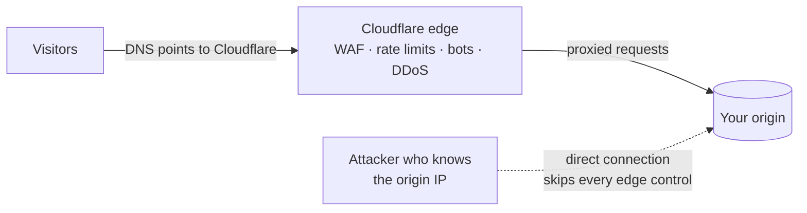
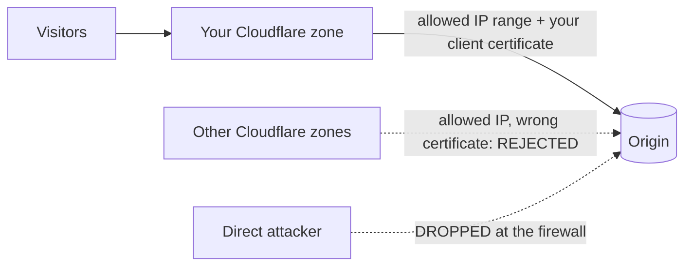

# Why origin protection matters now

**Cloudflare can only protect traffic that goes through Cloudflare.**

Every protection you pay for (WAF rules, rate limiting, bot management, DDoS
mitigation, Under Attack mode) runs at Cloudflare's edge. If your origin server
still answers anyone who connects to its IP address, an attacker who learns
that address simply goes around the edge, and none of those protections apply.

This is not a new idea. What has changed is how easy the bypass has become, how
many ordinary setups allow it without anyone noticing, and how often the usual
fix leaves the door half open.

---

## 1. Finding an origin is now an automated, continuous process

Internet-wide scanners connect to every IPv4 address and record the TLS
certificate and web page that each one serves. Passive-DNS archives keep every
answer a domain has ever returned. So an origin that ever served your
certificate, or ever appeared in your DNS, is effectively already on file.

Your origin's IP can also leak through:

- one DNS-only record
- an SPF record that names the server
- the headers of a password-reset email
- a webhook or link-preview fetch from your app

**Hiding the IP is not a control.** Assume the address is known, and make
direct connections fail.

## 2. Today's default setups open new side doors

| Default | The side door it opens |
|---|---|
| **Docker** publishes container ports through its own NAT rules. | Host firewalls such as ufw never see that traffic. A host can say "allow 443 only from Cloudflare" and still serve a container to the whole internet. |
| **HTTP/3** runs over **UDP**, and some servers (Caddy, for example) turn it on by default. | Cloudflare never connects to origins over HTTP/3, but a TCP-only firewall rule leaves UDP 443 wide open. |
| **IPv6** gets added to servers and DNS without the same firewall rules. | A host locked down on IPv4 is often wide open on IPv6. |
| **Managed platforms and load balancers** keep public default hostnames (`*.herokuapp.com`, `*.onrender.com`, `*.elb.amazonaws.com`...). | Those hostnames serve your app without going through Cloudflare. |

## 3. The popular fixes are half-fixes

| Popular fix | What it actually proves |
|---|---|
| **Allowlisting Cloudflare's IP ranges** | Nothing about *your* account. The ranges are shared by every Cloudflare customer, so anyone can create their own zone, point it at your origin IP, and arrive "from Cloudflare". |
| **Global Authenticated Origin Pulls** | Only that the request came through Cloudflare. Cloudflare's documentation says the certificate it provides for global AOP is shared across accounts. You need AOP with **your own** certificate (zone-level or per-hostname), a secret header, a Tunnel, or dedicated egress IPs. |
| **mTLS on HTTPS** | Nothing on port 80. In Full and Full (strict) modes, Cloudflare reaches the origin using the visitor's scheme, so a plain-HTTP visit arrives as plain HTTP, where client certificates don't exist. If port 80 serves your app, mTLS on 443 can be walked around. |

## 4. You are paying for protections an attacker can skip

A direct hit on the origin never meets your WAF rules, rate limits, bot scores
or caching. It also hides in your logs as an ordinary request: unless the
origin restores the real visitor IP correctly, every request looks like it came
from Cloudflare anyway.

## 5. A leaked IP cannot be un-leaked

Once an address is in scan data or DNS history, there are only two ways out:
make the address useless (allowlist plus origin authentication), or move. Moving
under attack is the worst time to do it. Locking down before an incident is a
planned change instead of an emergency.

## 6. AI assistants now configure servers, and their default answer is the half-fix

More and more infrastructure is set up by asking an AI assistant. Ask a generic
assistant to "protect my origin behind Cloudflare" and it usually suggests
allowlisting Cloudflare's IP ranges and stops there. That leaves every gap
above open.

This skill gives the assistant the complete playbook, including the traps, and
tools that **verify** the result instead of assuming it.

---

## What "protected" actually means

An origin is protected when it passes all three of these tests:

1. **Network.** From outside Cloudflare, every origin address and port refuses
   you, on IPv4 **and** IPv6, TCP **and** UDP.
2. **Identity.** A request that arrives from an "allowed" Cloudflare address
   but lacks *your* zone's proof is rejected. That proof is your AOP
   certificate or your secret header.
3. **Proof.** You verify both from outside, on a schedule, not once.

## How this project gets you there

| Step | What you use | What you get |
|---|---|---|
| **Audit** | `check_origin_lockdown.py` | A verdict per address and port in seconds: LOCKED, REACHABLE, EXPOSED or UNTESTED. It also shows what an internet scanner sees on the bare IP. |
| **Harden** | `generate_cf_firewall_rules.py`, plus the skill's playbooks | Validated rules from Cloudflare's live ranges, for nftables, iptables, ufw, AWS, GCP, Windows and nginx/Apache/Caddy. The playbooks cover AOP with your own certificate, Tunnel, Docker, Kubernetes, PaaS and incident response. |
| **Verify** | The same checker, from CI or a monitor | Exit codes that page you when something reopens. |

## References

- Cloudflare: [Authenticated Origin Pulls](https://developers.cloudflare.com/ssl/origin-configuration/authenticated-origin-pull/)
- Cloudflare: [SSL/TLS mode Full](https://developers.cloudflare.com/ssl/origin-configuration/ssl-modes/full/)
- Cloudflare: [Tunnel DNS records](https://developers.cloudflare.com/cloudflare-one/networks/connectors/cloudflare-tunnel/routing-to-tunnel/dns/)
- Cloudflare: [HTTP/3](https://developers.cloudflare.com/speed/optimization/protocol/http3/)
- Cloudflare: [Request Header Transform Rules](https://developers.cloudflare.com/rules/transform/request-header-modification/)
- Cloudflare: [Dedicated CDN Egress IPs](https://developers.cloudflare.com/aegis/)
- Cloudflare: [IP ranges](https://www.cloudflare.com/ips/)
- Docker: [Packet filtering and firewalls](https://docs.docker.com/engine/network/packet-filtering-firewalls/)
- Caddy: [Global options (`servers`, `protocols`)](https://caddyserver.com/docs/caddyfile/options)
- nginx: [ngx_http_ssl_module (`ssl_reject_handshake`, `ssl_verify_client`)](https://nginx.org/en/docs/http/ngx_http_ssl_module.html)
